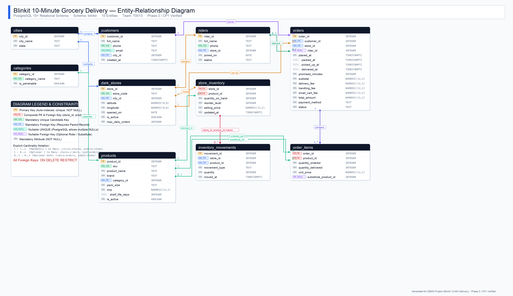
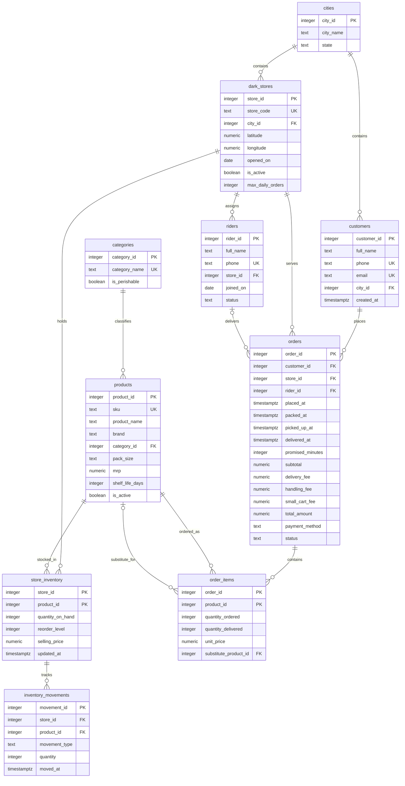

# Blinkit Database Schema Design

## 1. Design Overview

The database uses PostgreSQL and a schema named `blinkit`.
Table and column names match the supplied CSV headers so the given
workload queries can run without renaming fields.

The design separates catalogue data, store inventory, customers, riders,
orders, order lines and inventory movements.

## 2. Data Dictionary

PK = primary key, FK = foreign key, UQ = unique, NN = NOT NULL.
Columns without NN allow NULL. All single-column primary keys use
INTEGER GENERATED BY DEFAULT AS IDENTITY.

### cities

| Column | Type | Constraints and reason |
|--------|------|------------------------|
| city_id | INTEGER | PK; identifies a city |
| city_name | TEXT | NN; city name |
| state | TEXT | NN; state name |

The pair `(city_name, state)` is UNIQUE to prevent duplicate city records.

### categories

| Column | Type | Constraints and reason |
|--------|------|------------------------|
| category_id | INTEGER | PK; identifies a category |
| category_name | TEXT | NN, UQ; category name |
| is_perishable | BOOLEAN | NN; perishability flag |

### dark_stores

| Column | Type | Constraints and reason |
|--------|------|------------------------|
| store_id | INTEGER | PK; identifies a store |
| store_code | TEXT | NN, UQ; business identifier |
| city_id | INTEGER | NN, FK → cities |
| latitude | NUMERIC(9,6) | NN; between -90 and 90 |
| longitude | NUMERIC(9,6) | NN; between -180 and 180 |
| opened_on | DATE | NN; opening date |
| is_active | BOOLEAN | NN; operating flag |
| max_daily_orders | INTEGER | NN; positive daily capacity |

### products

| Column | Type | Constraints and reason |
|--------|------|------------------------|
| product_id | INTEGER | PK; identifies a product |
| sku | TEXT | NN, UQ; stock-keeping identifier |
| product_name | TEXT | NN; catalogue name |
| brand | TEXT | NN; brand name |
| category_id | INTEGER | NN, FK → categories |
| pack_size | TEXT | NN; includes units such as g or kg |
| mrp | NUMERIC(12,2) | NN; nonnegative monetary value |
| shelf_life_days | INTEGER | NULL allowed; positive when supplied |
| is_active | BOOLEAN | NN; catalogue availability flag |

### customers

| Column | Type | Constraints and reason |
|--------|------|------------------------|
| customer_id | INTEGER | PK; identifies a customer |
| full_name | TEXT | NN; customer name |
| phone | TEXT | NN, UQ; contact identifier (NOT NULL, UNIQUE) |
| email | TEXT | Nullable UNIQUE (UQ, NULL allowed); optional contact detail |
| city_id | INTEGER | NN, FK → cities (city_id) |
| created_at | TIMESTAMPTZ | NN; preserves the timestamp's instant |

PostgreSQL UNIQUE permits multiple NULL emails while preventing duplicate
non-NULL email values. Because NULL values are permitted, email is treated
strictly as a nullable UNIQUE column rather than a formal relational
candidate key (which requires NOT NULL under relational theory).

### riders

| Column | Type | Constraints and reason |
|--------|------|------------------------|
| rider_id | INTEGER | PK; identifies a rider |
| full_name | TEXT | NN; rider name |
| phone | TEXT | NN, UQ; contact identifier |
| store_id | INTEGER | NN, FK → dark_stores |
| joined_on | DATE | NN; joining date |
| status | TEXT | NN; must not be blank |

### store_inventory

| Column | Type | Constraints and reason |
|--------|------|------------------------|
| store_id | INTEGER | PK part, FK → dark_stores |
| product_id | INTEGER | PK part, FK → products |
| quantity_on_hand | INTEGER | NN; nonnegative stock |
| reorder_level | INTEGER | NN; nonnegative threshold |
| selling_price | NUMERIC(12,2) | NN; nonnegative store price |
| updated_at | TIMESTAMPTZ | NN; inventory update instant |

The composite PK `(store_id, product_id)` allows one inventory record
for each product at a store.

### orders

| Column | Type | Constraints and reason |
|--------|------|------------------------|
| order_id | INTEGER | PK; identifies an order |
| customer_id | INTEGER | NN, FK → customers (customer_id) |
| store_id | INTEGER | NN, FK → dark_stores (store_id) |
| rider_id | INTEGER | Optional FK (FK, NULL allowed) → riders (rider_id) |
| placed_at | TIMESTAMPTZ | NN; order creation instant |
| packed_at | TIMESTAMPTZ | Optional packing instant |
| picked_up_at | TIMESTAMPTZ | Optional pickup instant |
| delivered_at | TIMESTAMPTZ | Optional delivery instant |
| promised_minutes | INTEGER | NN; positive SLA duration |
| subtotal | NUMERIC(12,2) | NN; nonnegative order subtotal |
| delivery_fee | NUMERIC(12,2) | NN; nonnegative fee |
| handling_fee | NUMERIC(12,2) | NN; nonnegative fee |
| small_cart_fee | NUMERIC(12,2) | NN; nonnegative fee |
| total_amount | NUMERIC(12,2) | NN; subtotal plus all three fees |
| payment_method | TEXT | NN; must not be blank |
| status | TEXT | NN; must not be blank |

A rider can be unassigned. Stage timestamps allow NULL for stages that
have not been reached, including cancelled orders.

Timestamp checks require:
- Packing cannot occur before placement.
- Pickup requires packing and cannot occur before it.
- Delivery requires pickup and cannot occur before it.

All seed rows loaded successfully under these rules. Exact NULL
distributions by order status have not been separately profiled.

### order_items

| Column | Type | Constraints and reason |
|--------|------|------------------------|
| order_id | INTEGER | PK part, FK → orders |
| product_id | INTEGER | PK part, FK → products |
| quantity_ordered | INTEGER | NN; greater than zero |
| quantity_delivered | INTEGER | NN; between zero and quantity_ordered |
| unit_price | NUMERIC(12,2) | NN; nonnegative historical price |
| substitute_product_id | INTEGER | Optional FK → products |

The composite PK `(order_id, product_id)` identifies an ordered product
within an order. A NULL substitute means no substitute product is recorded.

### inventory_movements

| Column | Type | Constraints and reason |
|--------|------|------------------------|
| movement_id | INTEGER | PK; identifies a movement |
| store_id | INTEGER | NN; part of composite FK → store_inventory(store_id, product_id) |
| product_id | INTEGER | NN; part of composite FK → store_inventory(store_id, product_id) |
| movement_type | TEXT | NN; RESTOCK, DAMAGE, EXPIRY or ADJUSTMENT |
| quantity | INTEGER | NN; signed stock change |
| moved_at | TIMESTAMPTZ | NN; movement instant |

The composite FK `(store_id, product_id) REFERENCES store_inventory(store_id, product_id)` ensures stock movements only reference valid product-store inventory combinations.
RESTOCK quantities must be positive. DAMAGE and EXPIRY quantities must
be negative. ADJUSTMENT permits either sign or zero.

## 3. Relationships and Delete Rules

| Parent | Child | Foreign Key Mapping | Cardinality (Parent : Child) | Relationship Description |
|--------|-------|---------------------|:----------------------------:|--------------------------|
| cities | dark_stores | `dark_stores.city_id → cities.city_id` | 1 : 1..* | One city contains one or more dark stores |
| cities | customers | `customers.city_id → cities.city_id` | 1 : 0..* | One city contains zero or more customers |
| categories | products | `products.category_id → categories.category_id` | 1 : 0..* | One category classifies zero or more products |
| dark_stores | riders | `riders.store_id → dark_stores.store_id` | 1 : 0..* | One dark store assigns zero or more riders |
| dark_stores | store_inventory | `store_inventory.store_id → dark_stores.store_id` | 1 : 0..* | One dark store holds zero or more inventory records |
| products | store_inventory | `store_inventory.product_id → products.product_id` | 1 : 0..* | One product is stocked in zero or more stores |
| customers | orders | `orders.customer_id → customers.customer_id` | 1 : 0..* | One customer places zero or more orders |
| dark_stores | orders | `orders.store_id → dark_stores.store_id` | 1 : 0..* | One dark store serves zero or more orders |
| riders | orders | `orders.rider_id → riders.rider_id` | 0..1 : 0..* | Rider assignment is optional at order placement |
| orders | order_items | `order_items.order_id → orders.order_id` | 1 : 1..* | One order contains one or more order lines |
| products | order_items | `order_items.product_id → products.product_id` | 1 : 0..* | One product occurs in zero or more order lines |
| products | order_items | `order_items.substitute_product_id → products.product_id` | 0..1 : 0..* | Product optionally acts as substitute |
| store_inventory | inventory_movements | `(store_id, product_id) → store_inventory(store_id, product_id)` | 1 : 0..* | Composite FK: inventory record tracks movements |

Stores and products have an M:N relationship through `store_inventory`.
Orders and products have an M:N relationship through `order_items`.

Every FK uses ON DELETE RESTRICT. Referenced records cannot be deleted
while dependent records exist. This protects order history and stock
records. Product and store activity flags support deactivation.

## 4. Functional Dependencies and Normalization

In the table below, "remaining attributes" means every other column
in that table.

| Table | Functional dependencies |
|-------|-------------------------|
| cities | city_id → remaining attributes; (city_name, state) → city_id |
| categories | category_id → remaining attributes; category_name → category_id |
| dark_stores | store_id → remaining attributes; store_code → store_id |
| products | product_id → remaining attributes; sku → product_id |
| customers | customer_id → remaining attributes; phone → customer_id |
| riders | rider_id → remaining attributes; phone → rider_id |
| store_inventory | (store_id, product_id) → quantity_on_hand, reorder_level, selling_price, updated_at |
| orders | order_id → remaining attributes |
| order_items | (order_id, product_id) → quantity_ordered, quantity_delivered, unit_price, substitute_product_id |
| inventory_movements | movement_id → remaining attributes |

A non-NULL customer email also uniquely identifies a customer. Because
email is nullable, it is not treated as an unconditional candidate key.

### Normal-form assessment

- All tables use atomic column values and satisfy 1NF.
- In composite-key tables, non-key attributes depend on the full key:
  inventory is specific to a store-product pair, and order-line values
  are specific to an order-product pair. This avoids partial dependencies.
- City, category, product and customer details are stored separately
  instead of being repeated in transaction tables.
- Under the stated business dependencies, cities, categories,
  dark_stores, products, customers, riders, store_inventory, order_items
  and inventory_movements are designed to satisfy 3NF/BCNF.
- No dependency such as city_name → state is assumed: city names can
  repeat across states.

### Intentional redundancy in orders

`total_amount` is determined by subtotal and the three fee columns.
This is a non-key dependency, so the stored order relation is not
claimed to satisfy strict 3NF/BCNF.

The total is retained to match the source export and workload. A CHECK
constraint enforces its arithmetic consistency.

`subtotal` summarizes order lines. Fees may follow pricing policies,
but no permanent fee formula is assumed without documented rules.
These amounts are retained as historical checkout values.

`store_inventory.quantity_on_hand` is a current stock snapshot.
Rebuilding it requires a known opening balance and complete movement
and sales history; it cannot be inferred from the supplied movements
alone. The stored snapshot supports fast stock checks.

`order_items.unit_price` records a historical price and is not required
to equal the current store selling price.

## 5. ER Diagram

The full Entity-Relationship Diagram is available in high-resolution at [`diagrams/er_diagram.png`](../diagrams/er_diagram.png) and [`diagrams/er_diagram.pdf`](../diagrams/er_diagram.pdf). The complete Mermaid specification is maintained at [`diagrams/er_diagram.mmd`](../diagrams/er_diagram.mmd).

### Mermaid Specification

## 6. Loading and Validation

The schema script ran successfully on an empty `blinkit_db` database.
All ten CSV files loaded successfully in dependency order.
Identity sequences were advanced to the imported maximum IDs.
ANALYZE completed after the load.

### Row counts reported by COPY

| Table | Expected | Loaded |
|-------|---------:|-------:|
| cities | 10 | 10 |
| categories | 12 | 12 |
| dark_stores | 120 | 120 |
| products | 1,500 | 1,500 |
| customers | 40,000 | 40,000 |
| riders | 1,800 | 1,800 |
| store_inventory | 126,000 | 126,000 |
| orders | 150,000 | 150,000 |
| order_items | 675,000 | 675,000 |
| inventory_movements | 90,000 | 90,000 |

### Integrity checks

| Check | Violations |
|-------|-----------:|
| Ordered product is missing from its order's store inventory | 0 |
| Assigned rider belongs to a different store | 0 |
| Substitute product is missing from its order's store inventory | 0 |

These are validation queries, not additional database constraints.

### Issues and limitations

- The README introduction mentions 675,000 orders, but its detailed
  dataset table and the actual import show 150,000 orders and
  675,000 order items.
- No constraint violations occurred during loading. The three checks
  above found no violations; this does not establish that every
  possible business rule has been validated.
- Status and payment-method columns currently reject blank values but
  do not restrict values to enumerated lists.
- SKU/store-code format checks and exact fee-policy checks are not
  currently enforced.

## 7. Baseline Index Policy

No explicit performance indexes were created.

PostgreSQL automatically created indexes for:
- The primary key of each of the ten tables.
- cities: UNIQUE (city_name, state).
- categories: UNIQUE (category_name).
- dark_stores: UNIQUE (store_code).
- products: UNIQUE (sku).
- customers: UNIQUE (phone) and UNIQUE (email).
- riders: UNIQUE (phone).

Foreign keys do not automatically create indexes on referencing columns.
Additional tuning indexes are reserved for the optimization phase.